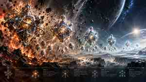

# Holon design research

This directory gathers Holon/Holoquary design research, source mining, and bounded reference/occurrence experiments.

## Conceptual illustration

**Crystalline Holon Evolution Timeline** is a conceptual illustration of a possible generational resilience pattern:

`GEN 0 → GEN 1 → GEN 2 → GEN 3 → GEN 4+`

The visual suggests a progression from a high-capacity, high-authority, resource-rich holon under extreme stress through progressively reduced/streamlined descendants, followed by retained growth potential and possible re-expansion.

### Evidence boundary

The illustration is **explanatory artwork, not a formal Holon specification, state machine, generation algorithm, proof, or accepted capability model**. Its labels must not be treated as canonical semantics unless separately established by an explicit design decision and supporting specification.

The existing Holon design material remains controlling evidence for established decisions and open questions.

## Research paths

- [September 30 handoff / October 31 mining](handoff-20260930-mining-20261031/) — consolidated Holon/Holoquary/reference research, source register, decisions, structures, patterns, and proof limits.
- [Reference occurrence inspector](reference-occurrence-inspector-20261101/) — bounded inspection work.
- [Reference occurrence pilot](reference-occurrence-pilot-20261101/) — bounded pilot work.

## Image provenance

Repository image:

`assets/crystalline-holon-evolution-timeline.jpg`

- repository representation: JPEG display derivative, 300 × 169
- repository JPEG SHA-256: `580284794072d09d4a754f93998b613a22e82c5f8585c5a2a22c03741eb37e8e`
- source supplied in the working conversation: PNG, 1672 × 941
- source PNG SHA-256: `b260006484468f82284a12dd51d09cfaba32feda8a89f88e634640e5992dd7a9`
- repository copy is a bounded downscaled JPEG derivative for repository display; it is not byte-identical to the supplied PNG.

No authorship claim is inferred from possession or upload of the source image.
